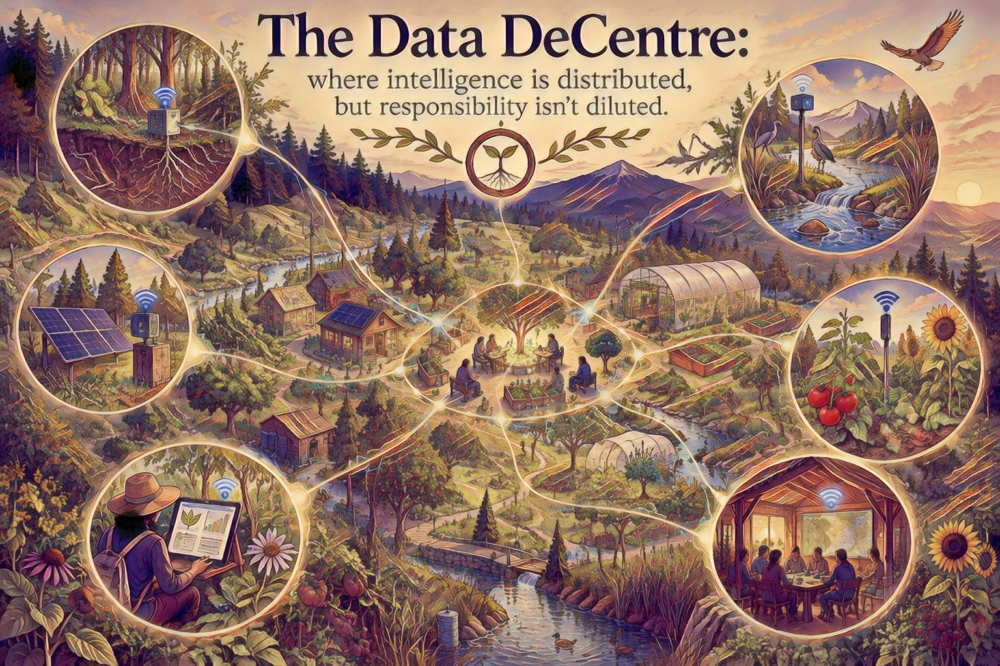

# Data DeCentre

> **Where intelligence is distributed, but responsibility isn't diluted.**

**Data DeCentre** is a Project Lichen design inquiry into computing infrastructure that is locally useful, energy-aware, physically integrated with communities, and capable of cooperating across scales.

It is not a proposal to abolish data centres or to declare that every computational task belongs on a small computer. It asks a more useful question:

> **What if we began with the places where people and living systems already need energy, shelter, information and coordinated action—and designed computing to strengthen those places?**

Data DeCentre connects [Data Distance](data-distance.md), [Technology](technology.md), [Regenerative Capability](regenerative-capability.md), [Alignment With Life](alignment-with-life.md), and [E-Cropolis](e-cropolis.md).

---

## From Data Centre to Data DeCentre

A conventional data centre concentrates substantial computing capability, electrical power, cooling, network capacity, equipment and operational expertise in one location.

Concentration can offer real advantages: economies of scale, specialized equipment, security, reliability and efficient utilization. Some workloads, including large-scale scientific computation and the training of substantial AI models, may benefit from this approach.

But concentration can also create long journeys for data, dependence upon distant infrastructure, single points of organizational control, pressure upon power and water systems, and impacts upon host communities.

**Data DeCentre** proposes a complementary architectural direction:

**distributed capability + shared standards + local accountability + selective coordination**

Rather than ask where another purpose-built computational facility should be placed, we might first ask which existing places could host useful, modest computational capability.

Homes. Workshops. Libraries. Schools. Greenhouses. Water-management facilities. Cooperative buildings. Community energy hubs.

These places already have purposes. Computing could serve those purposes rather than determine them.

---

## The Building as a Useful Starting Point

A building already mediates flows of electricity, heat, air, water, materials, waste, people, knowledge, communications and control.

A Data DeCentre treats computing as one more participant in these flows.

A modest computing node might support local sensor interpretation, building control, shared knowledge, a local language model, environmental monitoring or community coordination.

Its waste heat might sometimes be useful for space or water heating, provided that temperature, season, demand and engineering economics actually support heat recovery.

A passively designed building could reduce heating and cooling loads before additional technology is introduced.

> **What useful capability can be added to this building without needlessly enlarging its material and energy dependencies?**

Not every building should host computing. Local suitability must be assessed rather than assumed.

---

## Wired First; Wireless at the Edge

Buildings need physical connections for electrical distribution, safety and many essential services. Their data networks can similarly begin with deliberate, maintainable wired infrastructure.

A wired-first design may offer predictable latency, stable throughput, more controllable security boundaries, lower radio congestion and opportunities to carry both communication and limited power.

**Ethernet** provides a widely understood foundation.

**Power over Ethernet (PoE)** can deliver data and electrical power through compatible cabling to suitable devices, including sensors, cameras and small network equipment. Its power budgets, cable losses and applicable standards must be respected.

**Power-line communication** can sometimes carry data over existing electrical wiring, but performance depends heavily upon wiring conditions and electrical noise. It is not automatically an equivalent substitute for structured Ethernet cabling.

Wireless remains valuable for mobile devices, inaccessible locations, temporary monitoring and ecological settings where laying cables would be disruptive.

> **Wireless can be an edge case, literally: useful where a wire does not make sense, rather than the default for everything.**

The objective is not technological purity. It is sensible, serviceable connectivity.

---

## Extract Meaning Closer to Its Origin

Data DeCentre extends the [Data Distance](data-distance.md) inquiry.

Consider two possible paths:

**sensor → raw data → distant network → remote computation → interpretation → local action**

or:

**sensor → local interpretation → meaningful event → local action → selective sharing**

The second path can reduce unnecessary data movement and enable timely decisions even during connectivity failures.

For example, a greenhouse might retain local control of ventilation and temperature based upon nearby measurements. Its community network could receive aggregated trends, exceptions or selected measurements needed for wider learning.

But local interpretation should not erase valuable evidence. Some raw data may be needed for calibration, troubleshooting, scientific reproducibility or later reinterpretation.

A responsible architecture therefore asks what to process locally, what to preserve, what to share and why.

**Local first does not mean local only.**

---

## Energy, Heat and Community Microgrids

Digital systems consume electricity. Their relationship with local energy systems matters as much as processor efficiency.

A Data DeCentre could coordinate with solar generation, batteries, demand management and community microgrids where lawful, safe and economically justified.

Some computing tasks are time-sensitive: alarms, communications, control and essential services.

Others can be scheduled: backups, indexing, bulk analysis, model updates and non-urgent scientific workloads.

Flexible workloads could operate when renewable generation is abundant, while essential workloads retain appropriate reliability.

A microgrid must also manage electrical protection, islanding, grid interconnection, maintenance and safe operating limits. Simply connecting computers and batteries does not create a resilient energy system.

### Vehicle to Community

Commercial electric vehicles may eventually contribute substantial flexible electrical storage because fleets often have predictable routes, charging points and periods of parking.

**Vehicle to Community** asks whether bidirectional charging could support shared buildings or critical services without compromising the vehicle's primary transportation duties.

This requires compatible vehicles and chargers, utility agreements, control systems, battery-wear evaluation and explicit community arrangements.

It is a design possibility, not an assumption that every electric vehicle can already supply a neighborhood.

---

## Distributed Intelligence; Undiluted Responsibility

Distributed hardware does not guarantee distributed power.

A network can place computers in many communities while retaining centralized ownership, opaque software, compulsory cloud dependencies or unaccountable control.

Data DeCentre therefore distinguishes physical distribution from meaningful stewardship.

A credible arrangement should clarify:

- who owns and maintains equipment
- who can inspect and change its software
- who controls the data and permissions
- who pays for energy, repair and replacement
- what happens when a node, network or operator fails
- how participants can leave without losing essential capabilities
- who is accountable for harmful decisions

Open protocols, documented interfaces, portable data and locally available operational knowledge can reduce dependence on any single supplier.

> **Intelligence may be distributed; responsibility must remain identifiable.**

Human participation is not an afterthought added to the technical architecture. It is one of the things the architecture exists to support.

---

## Ecological and Community Accountability

A distributed system is not necessarily greener merely because its devices are smaller or nearer their users.

Many poorly utilized machines could consume more resources than one efficiently operated shared facility. Manufacturing, mining, electronics disposal, network equipment and batteries all have embodied impacts.

Similarly, a large facility may achieve very good computing efficiency while imposing unacceptable local burdens through electricity demand, water use, noise, land conversion or changes in community infrastructure.

Both conditions deserve examination.

A Data DeCentre evaluation should therefore include:

**Operational:** useful work completed; energy consumption; idle power; latency; availability; maintainability.

**Material:** equipment lifetimes; repairability; reused hardware; embodied emissions; recycling and disposal.

**Ecological:** water consumption; land disturbance; biodiversity effects; electricity-system impacts; heat recovery where useful.

**Social:** affordability; accessibility; consent; privacy; local skills; governance; community benefits and burdens.

**Epistemic:** quality of observations; provenance; uncertainty; error correction; reproducibility; visibility into automated decisions.

A technically impressive architecture is not an ecological success merely because it works.

---

## A Network of Modest Nodes

Imagine a community containing a library, a workshop, several homes, a greenhouse and a water-management building.

Each location may have a modest computer, appropriate wired links and sensors relevant to its purposes.

Local nodes continue to perform essential functions if an internet link becomes unavailable.

Selected observations are shared according to explicit permissions. A regional system can combine information that no individual node possesses. More demanding work may be delegated to larger shared infrastructure when it is genuinely advantageous.

No individual building needs to contain all knowledge or all capability.

This resembles a living system only in a limited, carefully stated sense: differentiated participants can contribute to a larger whole without being identical or wholly dependent upon one central decision point.

Biological analogy is a source of questions, not proof that an engineering design will work.

---

## A Small Practical Experiment

Before designing a regional network, begin with one understandable experiment.

**Question:** Can a small wired local node interpret environmental observations and retain useful local capability during an internet interruption?

### Proposed arrangement

1. Connect one modest computer and one or more sensors over a local wired network, using PoE where appropriate.
2. Record environmental measurements and the electricity used by the computing and network equipment.
3. Interpret selected events locally; preserve enough source measurements for verification.
4. Expose a simple, documented local interface for people to inspect observations and decisions.
5. Disconnect the external internet link in a controlled test; observe what continues to function.
6. Restore connectivity and share only the information explicitly selected for wider use.
7. Compare results with an equivalent remotely processed workflow where feasible.

### Record what actually happens

Measure energy consumption, idle load, bandwidth, latency, outages, cost, maintenance effort and the usefulness of the information produced.

Record failures and surprises, not merely successes.

A null result is valuable. If a centralized approach proves more efficient or reliable for a given task, that should influence the design.

---

## Connections to Project Lichen

### Data Distance

How much movement and translation are truly necessary before observation becomes meaning and action?

### Regenerative Capability

What capacities remain after equipment ages, funding ends, services fail or participants change?

### Alignment With Life

Does the infrastructure improve human and ecological livability, or simply increase computational throughput?

### E-Cropolis

Could simulation explore how local computing, building performance, food systems, energy networks, water and community decisions interact—without pretending the simulation already knows the right answer?

Data DeCentre may become one of the infrastructure experiments informing E-Cropolis, not a requirement imposed upon its current development.

---

## An Open Inquiry

Data DeCentre is a working hypothesis and design direction, not a completed engineering specification or an established claim of superior efficiency.

Its propositions should remain testable:

- Can moving interpretation closer to observations reduce total resource use?
- Can infrastructure embedded in existing buildings create more durable local capability?
- When does shared central computation outperform local operation?
- Which workloads benefit from energy-aware scheduling?
- Can interoperable local nodes improve resilience without multiplying maintenance burdens?
- What forms of ownership and governance keep responsibility clear?
- How might these systems enlarge the capabilities of communities and the living places they inhabit?

The ambition is not to make every community into a miniature data centre.

It is to ask whether computing can become a modest, accountable participant in the places where life already happens.

> **Data DeCentre: where intelligence is distributed, but responsibility isn't diluted.**

---

**Project Lichen**  
*Stewardship Across Generations*  
*Working concept — version 0.1, 23 October 2026*
